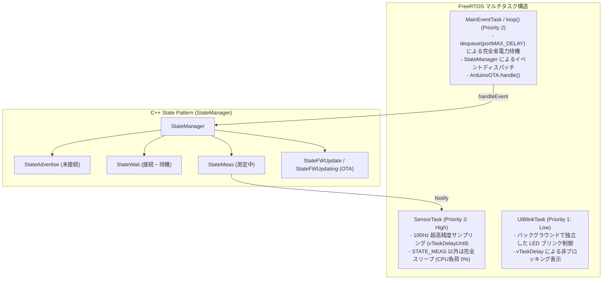

# 概要

本デバイスは、M5Stamp Pico と 2 つの GY-521 (MPU6050 6軸センサ) を用い、高精度な 6 軸運動データ（加速度 `g`, 角速度 `dps`）を **100Hz の高精度リアルタイムサンプリング** で BLE 送信することを目的とした組み込みデバイスです。

---

## 🚀 システムアーキテクチャ

本デバイスは **C++ State Pattern（状態パターン）** と **FreeRTOS マルチタスク構造** を統合した設計となっています。



---

## 💡 LED ステータス表示仕様 (省電力ブリンク)

内蔵 SK6812 RGB LED を用いて、各状態を独立したバックグラウンドタスク (`UIBlinkTask`) から視認性高く点滅表示します。明るさは省電力・低眩しさ（`brightness = 20`）に最適化されています。

| 状態名 | 状態クラス | LED カラー | 点滅パターン | 備考 |
|---|---|---|---|---|
| **アドバタイズ中** | `StateAdvertise` | 🔵 青色 | 1秒周期 (100ms ON / 900ms OFF) | 未接続・接続待ち |
| **接続・待機中** | `StateWait` | 🟢 緑色 | 1秒周期 (100ms ON / 900ms OFF) | BLE接続中・コマンド待機 |
| **測定中** | `StateMeas` | 🔴 赤色 | 高速点滅 (100ms ON / 400ms OFF) | 100Hz データサンプリング中 |
| **OTA 待機** | `StateFWUpdate` | 🟣 紫色 | 1秒周期 (100ms ON / 900ms OFF) | FWアップデートモード |
| **OTA 書込中** | `StateFWUpdating` | 🩵 水色 | 常時点灯 (Solid ON) | ファームウェア書き込み中 |

---

# ブロック図 / 回路構成図

```mermaid
graph TD;
    subgraph Battery ["リチウム電池 (3.7V~4.2V)"]
        BAT_POS["(+) VBAT"]
        BAT_NEG["(-) GND"]
    end

    subgraph Switch ["電源スイッチ"]
        SW["スライドスイッチ (SW)"]
    end

    subgraph LDO ["3.3V 1A LDO レギュレータ (TA48033S)"]
        LDO_IN["IN"]
        LDO_GND["GND"]
        LDO_OUT["OUT (3.3V)"]
    end

    subgraph M5Stamp ["M5Stamp Pico"]
        M5_3V3["3.3V Pin"]
        M5_GND["GND Pin"]
        M5_SDA["G21 (SDA)"]
        M5_SCL["G22 (SCL)"]
    end

    subgraph GY521_1 ["GY-521 #1 (0x68 Primary)"]
        G1_VCC["VCC"]
        G1_GND["GND"]
        G1_SDA["SDA"]
        G1_SCL["SCL"]
        G1_AD0["AD0 (GND固定)"]
    end

    subgraph GY521_2 ["GY-521 #2 (0x69 Secondary)"]
        G2_VCC["VCC"]
        G2_GND["GND"]
        G2_SDA["SDA"]
        G2_SCL["SCL"]
        G2_AD0["AD0 (3.3V固定)"]
    end

    %% 電源ライン接続
    BAT_POS -->|VBAT| SW
    SW -->|SW_VBAT (3.7~4.2V)| LDO_IN
    SW -->|SW_VBAT (3.7~4.2V)| G1_VCC
    SW -->|SW_VBAT (3.7~4.2V)| G2_VCC

    LDO_OUT -->|3.3V| M5_3V3
    LDO_OUT -->|3.3V| G2_AD0

    BAT_NEG --> LDO_GND
    BAT_NEG --> M5_GND
    BAT_NEG --> G1_GND
    BAT_NEG --> G2_GND
    BAT_NEG --> G1_AD0

    %% I2C バス接続
    M5_SDA === G1_SDA
    M5_SDA === G2_SDA
    M5_SCL === G1_SCL
    M5_SCL === G2_SCL
```

---

# 📁 ディレクトリ構成

```
DualGY521_M5Stamp/
├── platformio.ini
├── README.md
│
├── web/                               # Web UI アプリケーション群
│   ├── debug.html                     # デバッグ・各種設定・3DモニターUI
│   └── motus_dashboard.html           # 野球投球動作アナリティクスUI
│
├── lib/                               # サードパーティ・モジュールライブラリ
│   └── MPU6050/                       # センサドライバを lib/ へ完全隔離
│       ├── I2Cdev.h
│       ├── I2Cdev.cpp
│       ├── MPU6050.h
│       └── MPU6050.cpp
│
├── include/                           # グローバル / モジュールヘッダー (.h)
│   ├── SixAxisSensor.h
│   ├── MyBLE.h
│   ├── common/                        # 共通ヘッダー群
│   │   ├── MemoryMap.h
│   │   ├── MyEvent.h
│   │   ├── MyFunc.h
│   │   ├── MyGlobal.h
│   │   └── MyState.h
│   └── states/                        # State Pattern ヘッダー群
│       ├── State.h
│       ├── StateManager.h
│       ├── StateAdvertise.h
│       ├── StateWait.h
│       ├── StateMeas.h
│       └── StateFWUpdate.h
│
└── src/                               # ソースファイル (.cpp)
    ├── main.cpp
    ├── SixAxisSensor.cpp
    ├── MyBLE.cpp
    ├── common/                        # 共通ロジックソース
    │   ├── MyFunc.cpp
    │   └── MyGlobal.cpp
    └── states/                        # State Pattern 実装ロジック
        ├── StateManager.cpp
        ├── StateAdvertise.cpp
        ├── StateWait.cpp
        ├── StateMeas.cpp
        └── StateFWUpdate.cpp
```

---

# ピン接続対応表

| モジュール | ピン名 | 接続先 | 備考 / 仕様 |
|---|---|---|---|
| **リチウム電池** | `(+) VBAT` | スライドスイッチ IN | 3.7V 〜 4.2V |
| | `(-) GND` | 共通 GND | 電源グランド |
| **スライドスイッチ** | `OUT` | `TA48033S (IN)`, `GY-521 #1 (VCC)`, `GY-521 #2 (VCC)` | スイッチ通過後のバッテリー電源ライン |
| **TA48033S (LDO)** | `IN` | スライドスイッチ OUT | 入力 (3.7V〜4.2V) |
| | `GND` | 共通 GND | |
| | `OUT (3.3V)` | `M5Stamp Pico (3.3V)`, `GY-521 #2 (AD0)` | 安定化 3.3V 電源 |
| **GY-521 #1 (0x68)** | `VCC` | スライドスイッチ OUT | モジュール内 LDO で 3.3V 化 |
| | `GND` | 共通 GND | |
| | `SDA` | `M5Stamp Pico (G21)` | I2C データライン |
| | `SCL` | `M5Stamp Pico (G22)` | I2C クロックライン |
| | `AD0` | **GND** | アドレス `0x68` に設定 |
| **GY-521 #2 (0x69)** | `VCC` | スライドスイッチ OUT | モジュール内 LDO で 3.3V 化 |
| | `GND` | 共通 GND | |
| | `SDA` | `M5Stamp Pico (G21)` | I2C データライン |
| | `SCL` | `M5Stamp Pico (G22)` | I2C クロックライン |
| | `AD0` | **3.3V** (`TA48033S OUT`) | アドレス `0x69` に設定 (※5V不可) |
| **M5Stamp Pico** | `3.3V` | `TA48033S OUT` | メインマイコン電源受電 |
| | `GND` | 共通 GND | |
| | `G21` | `GY-521 #1 (SDA)`, `GY-521 #2 (SDA)` | I2C データ |
| | `G22` | `GY-521 #1 (SCL)`, `GY-521 #2 (SCL)` | I2C クロック |

---

# BLE セキュリティ & コマンド仕様

### 🔒 セキュリティ認証設定
- **PASSKEY (PIN コード)**: `123456`
- **保護属性**: MITM 保護付きアクセス暗号化要求 (`ESP_GATT_PERM_READ_ENC_MITM | ESP_GATT_PERM_WRITE_ENC_MITM`)
- **安全保護**: PIN コード未入力・不一致の場合は**即座に自動断線（Disconnect）**。

### 📡 BLE コマンド一覧

| 概要 | コマンドコード | 引数 | 応答通知 |
|---|---|---|---|
| **機器情報取得** | `0x00, 0x01` | なし | `device_version,0.3.0` |
| **連続測定開始** | `0x01, 0x00` | なし | 52 Byte Binary Data Notification (100Hz) |
| **連続測定停止** | `0x01, 0x01` | なし | なし |
| **Wi-Fi SSID 設定** | `0x02, 0x00` | SSID (ASCII) | `wifi_ssid,<設定値>` (EEPROM保存) |
| **Wi-Fi SSID 取得** | `0x02, 0x00` | なし | `wifi_ssid,<保持値>` |
| **Wi-Fi PW 設定** | `0x02, 0x01` | PW (ASCII) | `wifi_pw,<設定値>` (EEPROM保存) |
| **Wi-Fi PW 取得** | `0x02, 0x01` | なし | `wifi_pw,<保持値>` |
| **Wi-Fi IP 取得** | `0x02, 0x02` | なし | `device_ip,<IPアドレス>` |
| **Wi-Fi 接続** | `0x02, 0x03` | なし | 接続開始 |
| **FW 更新開始** | `0x03, 0x00` | なし | OTAモードに移行 |
| **FW Host 設定** | `0x03, 0x01` | Host (ASCII) | `fw_host,<設定値>` (EEPROM保存) |
| **FW Host 取得** | `0x03, 0x01` | なし | `fw_host,<保持値>` |
| **センサ設定 設定** | `0x04, 0x00` | Acc, Gyro | `sensor_cfg,{...}` (EEPROM保存) |
| **センサ設定 取得** | `0x04, 0x01` | なし | `sensor_cfg,{...}` |

---

# 📦 測定データパケット仕様 (52 Bytes float32)

### 1 サンプリング構造体 (`SensorPacket`)

設定されている Range (フルスケールレンジ) に応じて、マイコン側で RAW 値から物理値へ高精度変換して送出されます。

```cpp
struct __attribute__((packed)) SensorPacket {
  uint16_t header = 0x0101; // 識別子 (2 Bytes)
  uint16_t count;          // パケットカウンタ (2 Bytes)
  float    acc1[3];        // GY-521 #1 Acc X, Y, Z (12 Bytes, 単位: g)
  float    gyro1[3];       // GY-521 #1 Gyro X, Y, Z (12 Bytes, 単位: dps)
  float    acc2[3];        // GY-521 #2 Acc X, Y, Z (12 Bytes, 単位: g)
  float    gyro2[3];       // GY-521 #2 Gyro X, Y, Z (12 Bytes, 単位: dps)
};
```

* **合計パケットサイズ**: **52 Bytes / Packet**
* **送信レート**: 100Hz (10ms 周期)
* **データ転送量**:
  - `52 Bytes * 100Hz = 5.2 kB/sec`
  - `5.2 kB * 60s = 312 kB/min`

---

# 💾 EEPROM メモリアドレスマップ

Flash メモリ内の EEPROM 設定領域 (1000 バイト確保) のレイアウト：

| アドレス (Hex) | アドレス (Dec) | サイズ (Byte) | 項目名 | 内容 / フォーマット |
|---|---|---|---|---|
| `0x00` | 0 | 1 | MAJOR_VERSION | メジャーバージョン (`uint8_t`) |
| `0x01` | 1 | 1 | MINOR_VERSION | マイナーバージョン (`uint8_t`) |
| `0x02` | 2 | 1 | REVISION_VERSION | リビジョンバージョン (`uint8_t`) |
| `0x10` | 16 | 1 | INIT_FLAG | 設定初期化済フラグ (`0xA5`) |
| `0x20` | 32 | 64 | WIFI_SSID | Wi-Fi SSID (Null終端文字列) |
| `0x60` | 96 | 64 | WIFI_PW | Wi-Fi パスワード (Null終端文字列) |
| `0xA0` | 160 | 64 | FW_HOST | FW 更新ホスト名/IP (Null終端文字列) |
| `0xE0` | 224 | 1 | ACC_RANGE | 加速度レンジ (`0`:±2g, `1`:±4g, `2`:±8g, `3`:±16g) |
| `0xE1` | 225 | 1 | GYRO_RANGE | ジャイロレンジ (`0`:±250dps, `1`:±500dps, `2`:±1000dps, `3`:±2000dps) |
| `0xF0` | 240 | 48 | OFFSET_DATA | ゼロ点キャリブレーションオフセット (`12 * float`) |

---

# 🌐 Web UI アプリケーション

### 1. ⚾ 野球投球動作解析ダッシュボード (`motus_dashboard.html`)
motus (PULSE Throw) 同等の投球アナリティクスを提供するプロ仕様の専用 Web アプリです。
* **自動投球検出 (Pitch Detection)**: 腕を振った瞬間のスイング速度を自動感知し、投球数・パラメータを分析
* **リアルタイム計測指標**:
  - **アームスピード (Max Arm Speed)**: 最高角速度 [`dps` / `rpm`]
  - **肘ストレス (Elbow Varus Torque)**: 肘の内側靭帯にかかる推定外反トルク [`Nm`]
  - **アームスロット (Arm Slot)**: リリリース時の腕の角度 [`°`]
* **セッション履歴ログ ＆ 動的波形モニター**

### 2. 🛠️ デバッグ・コントロール UI (`debug.html`)
* **ゼロ点キャリブレーション**: デバイスを水平静止させて校正ボタンを押すことで、100サンプル測定しオフセットを EEPROM に永続保存
* **10Hz レンダリングスロットリング ＆ 6軸波形モニター**
