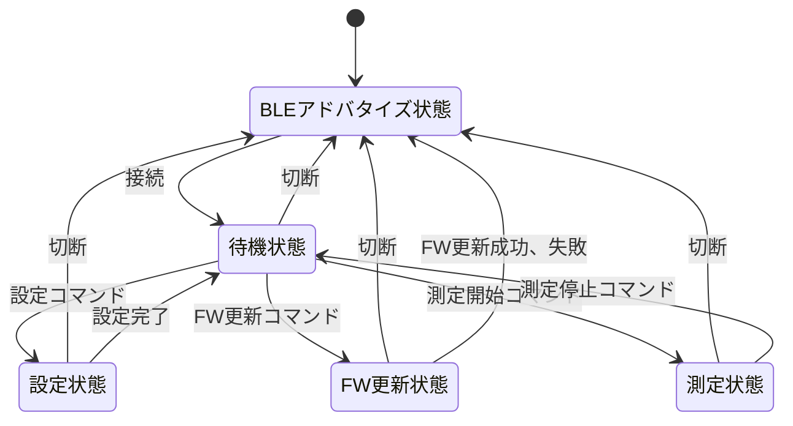

# 概要

本デバイスは、2 つの GY521 から得られる加速度、ジャイロデータを BLE で送信することをメイン機能としている。

# ブロック図 / 回路構成図

```mermaid
graph TD;
    subgraph Battery ["リチウム電池 (3.7V~4.2V)"]
        BAT_POS["(+) VBAT"]
        BAT_NEG["(-) GND"]
    end

    subgraph Switch ["電源スイッチ"]
        SW["スライドスイッチ (SW)"]
    end

    subgraph LDO ["3.3V 1A LDO レギュレータ (TA48033S)"]
        LDO_IN["IN"]
        LDO_GND["GND"]
        LDO_OUT["OUT (3.3V)"]
    end

    subgraph M5Stamp ["M5Stamp Pico"]
        M5_3V3["3.3V Pin"]
        M5_GND["GND Pin"]
        M5_SDA["G21 (SDA)"]
        M5_SCL["G22 (SCL)"]
    end

    subgraph GY521_1 ["GY-521 #1 (0x68 Primary)"]
        G1_VCC["VCC"]
        G1_GND["GND"]
        G1_SDA["SDA"]
        G1_SCL["SCL"]
        G1_AD0["AD0 (GND固定)"]
    end

    subgraph GY521_2 ["GY-521 #2 (0x69 Secondary)"]
        G2_VCC["VCC"]
        G2_GND["GND"]
        G2_SDA["SDA"]
        G2_SCL["SCL"]
        G2_AD0["AD0 (3.3V固定)"]
    end

    %% 電源ライン接続
    BAT_POS -->|VBAT| SW
    SW -->|SW_VBAT (3.7~4.2V)| LDO_IN
    SW -->|SW_VBAT (3.7~4.2V)| G1_VCC
    SW -->|SW_VBAT (3.7~4.2V)| G2_VCC

    LDO_OUT -->|3.3V| M5_3V3
    LDO_OUT -->|3.3V| G2_AD0

    BAT_NEG --> LDO_GND
    BAT_NEG --> M5_GND
    BAT_NEG --> G1_GND
    BAT_NEG --> G2_GND
    BAT_NEG --> G1_AD0

    %% I2C バス接続
    M5_SDA === G1_SDA
    M5_SDA === G2_SDA
    M5_SCL === G1_SCL
    M5_SCL === G2_SCL
```

# ピン接続対応表

| モジュール | ピン名 | 接続先 | 備考 / 仕様 |
|---|---|---|---|
| **リチウム電池** | `(+) VBAT` | スライドスイッチ IN | 3.7V 〜 4.2V |
| | `(-) GND` | 共通 GND | 電源グランド |
| **スライドスイッチ** | `OUT` | `TA48033S (IN)`, `GY-521 #1 (VCC)`, `GY-521 #2 (VCC)` | スイッチ通過後のバッテリー電源ライン |
| **TA48033S (LDO)** | `IN` | スライドスイッチ OUT | 入力 (3.7V〜4.2V) |
| | `GND` | 共通 GND | |
| | `OUT (3.3V)` | `M5Stamp Pico (3.3V)`, `GY-521 #2 (AD0)` | 安定化 3.3V 電源 |
| **GY-521 #1 (0x68)** | `VCC` | スライドスイッチ OUT | モジュール内 LDO で 3.3V 化 |
| | `GND` | 共通 GND | |
| | `SDA` | `M5Stamp Pico (G21)` | I2C データライン |
| | `SCL` | `M5Stamp Pico (G22)` | I2C クロックライン |
| | `AD0` | **GND** | アドレス `0x68` に設定 |
| **GY-521 #2 (0x69)** | `VCC` | スライドスイッチ OUT | モジュール内 LDO で 3.3V 化 |
| | `GND` | 共通 GND | |
| | `SDA` | `M5Stamp Pico (G21)` | I2C データライン |
| | `SCL` | `M5Stamp Pico (G22)` | I2C クロックライン |
| | `AD0` | **3.3V** (`TA48033S OUT`) | アドレス `0x69` に設定 (※5V不可) |
| **M5Stamp Pico** | `3.3V` | `TA48033S OUT` | メインマイコン電源受電 |
| | `GND` | 共通 GND | |
| | `G21` | `GY-521 #1 (SDA)`, `GY-521 #2 (SDA)` | I2C データ |
| | `G22` | `GY-521 #1 (SCL)`, `GY-521 #2 (SCL)` | I2C クロック |

# 状態遷移図



# BLE コマンド（スマホが送信側）

| 概要              | コマンド番号 | 引数          | 応答                         |
| ----------------- | ------------ | ------------- | ---------------------------- |
|                   | 2byte        | 任意 byte     | 任意 byte                    |
| 機器情報取得      | 0x00, 0x01   | なし          | 機器情報(json)               |
| 連続測定開始      | 0x01, 0x00   | なし          | 2 つの 6 軸センサの値        |
| 連続測定終了      | 0x01, 0x01   | なし          | なし                         |
| Wifi SSID 設定    | 0x02, 0x00   | SSID（ascii） | 設定した SSID(ascii)         |
| Wifi SSID 取得    | 0x02, 0x00   | なし          | 設定した SSID(ascii)         |
| Wifi PW 設定      | 0x02, 0x01   | PW(ascii)     | 設定した PW(ascii)           |
| Wifi IP 取得      | 0x02, 0x02   | なし          | ネット接続時:IP、未接続:None |
| Wifi 接続         | 0x02, 0x03   | なし          | ネット接続時:IP、未接続:None |
| FW 更新           | 0x03, 0x00   | なし          | 更新開始：0x01,不必要:0x00   |
| FW 更新 Host 設定 | 0x03, 0x01   | Host(ascii)   | 設定した Host(ascii)         |
| FW 更新 Host 取得 | 0x03, 0x01   | なし          | 設定した Host(ascii)         |
| センサ設定 設定    | 0x04, 0x00   | Acc,Gyro,Thresh | 設定後の JSON                |
| センサ設定 取得    | 0x04, 0x01   | なし          | 設定済の JSON                |

# 1 測定データのサイズ

## 1 サンプリング

2byte _ 6(acc+gyro) _ 2(センサ) = 24byte
※測定時に加速度・ジャイロのスケールの Range を取得しておくように。

## 100Hz で 1 分間測定

24byte _ 100 = 2400byte = 2.4kB/sec
2.4kB _ 60 = 144 kB

RAM: [== ] 16.8% (used 55108 bytes from 327680 bytes)
Flash: [======== ] 78.4% (used 1541181 bytes from 1966080 bytes)

# EEPROM メモリアドレスマップ

EEPROM(Flash) 設定領域（1000バイト確保）のメモリレイアウト：

| アドレス (Hex) | アドレス (Dec) | サイズ (Byte) | 項目名 | 内容 / フォーマット |
|---|---|---|---|---|
| `0x00` | 0 | 1 | MAJOR_VERSION | メジャーバージョン (`uint8_t`) |
| `0x01` | 1 | 1 | MINOR_VERSION | マイナーバージョン (`uint8_t`) |
| `0x02` | 2 | 1 | REVISION_VERSION | リビジョンバージョン (`uint8_t`) |
| `0x10` | 16 | 1 | INIT_FLAG | 設定初期化済フラグ (`0xA5`) |
| `0x20` | 32 | 64 | WIFI_SSID | Wi-Fi SSID (Null終端文字列) |
| `0x60` | 96 | 64 | WIFI_PW | Wi-Fi パスワード (Null終端文字列) |
| `0xA0` | 160 | 64 | FW_HOST | FW 更新ホスト名/IP (Null終端文字列) |
| `0xE0` | 224 | 1 | ACC_RANGE | 加速度レンジ (`0`:±2g, `1`:±4g, `2`:±8g, `3`:±16g) |
| `0xE1` | 225 | 1 | GYRO_RANGE | ジャイロレンジ (`0`:±250dps, `1`:±500dps, `2`:±1000dps, `3`:±2000dps) |
| `0xE2` | 226 | 1 | MOTION_THRESH | 動作検出スレッショルド (`uint8_t`) |

